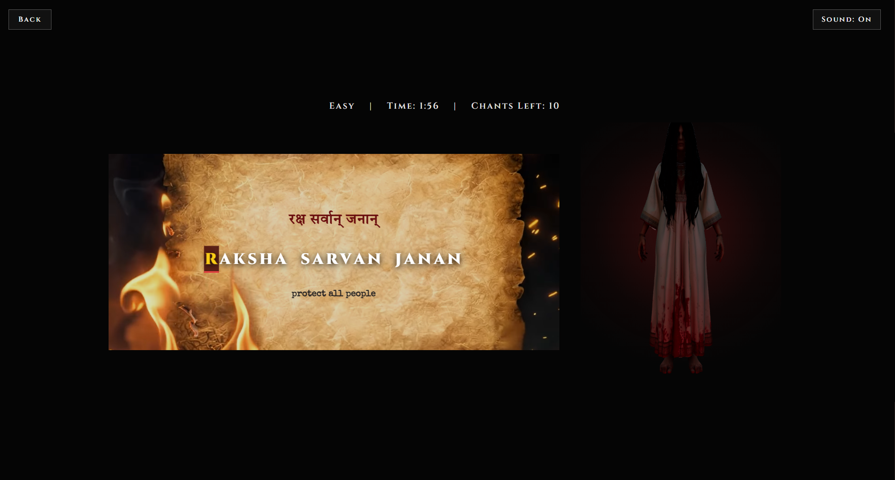
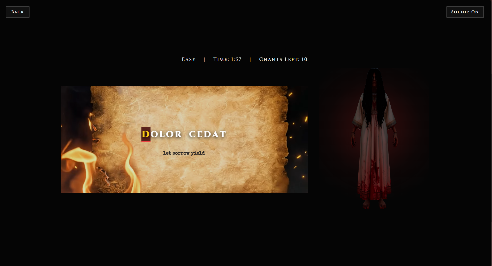

## Disclaimer & Respect Notice

This game is a work of fiction created purely for entertainment a horror game . I deeply respect all religions, cultures, sacred traditions and languages including Sanskrit and Latin. No sacred names,chants are misused and there is zero intention to hurt, disrespect or misrepresent any faith or linguistic heritage.

# Exorcism Typer


**Exorcism Typer** . It is a horror themed typing game where you pick Sanskrit or Latin mantra or chants , choose a difficulty level, and try to finish typing all the mantra before the timer runs out and ghost kill you.

## Demo 

**Link:** 


## Tech Stack & How It Was Made

I built this project using
- **React** and **Vite** for the frontend.
- **Three.js** with `@react-three/fiber` and `@react-three/drei` to render the 3D ghost model
- **Motion** (`motion/react`) for text animations and jumpscare shakes

### Features

- **2 Language:** Sanskrit and Latin 


- **Typing & Manuscript Box:** Built character by character typing detection for Sanskrit and Latin lines over a  `paper.webm` burning-parchment video background.

- **3D Ghost Framing & Lighting:** The 3D model of ghost and tuned the rim and crimson red color lighting.

- **Audio System:** Added a Sound On/Off toggle button, a looping ambient background track whose volume scales with difficulty and a separate scare sound effect triggered when mistyping or touching the ghost with the cursor.

- **Difficulty Timer & Win/Lose Flow:** Added Easy (2 min / 10 chants), Medium (1 min / 6 chants) and Hard (1 min / 10 chants) modes showing remaining chants. Completing all chants you exorsit the ghost and win game, while running out of time not completing the chant result in lose 

- **Text Animation:** using motion made text animation.


## How to Run Locally

1. Clone the repository and open the folder:
   ```bash
   git clone https://github.com/Sooraj44882/exorcism-typer.git
   cd exorcism-typer
   ```

2. Install the dependencies:
   ```bash
   npm install
   ```

4. Start the development server:
   ```bash
   npm run dev
   ```


## AI Disclosure

AI was used only to write the mantras and chants. I do not know the languages & it meaning.Instead of taking from real with god name and others stuff .I wanted to avoid hurting anyone beliefs so I used AI to make  with native script and meaning  without any god names or sacred text.

I only made this words.jsx file only with AI .And all other stuff is made by me .


